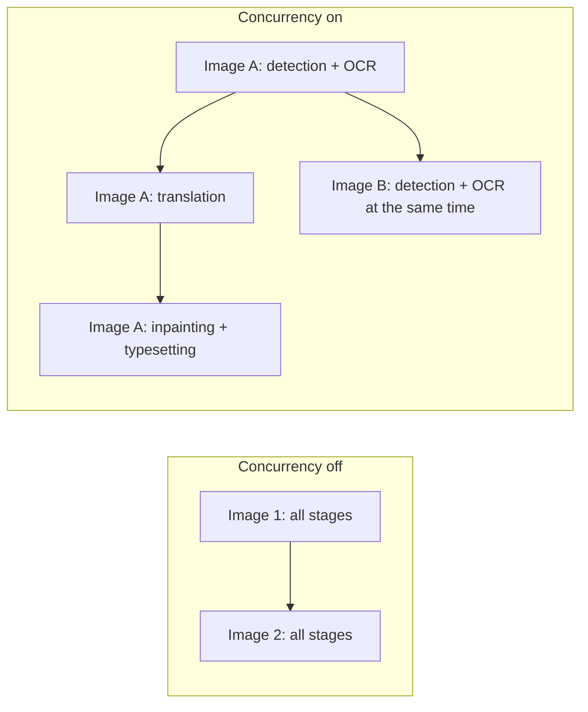
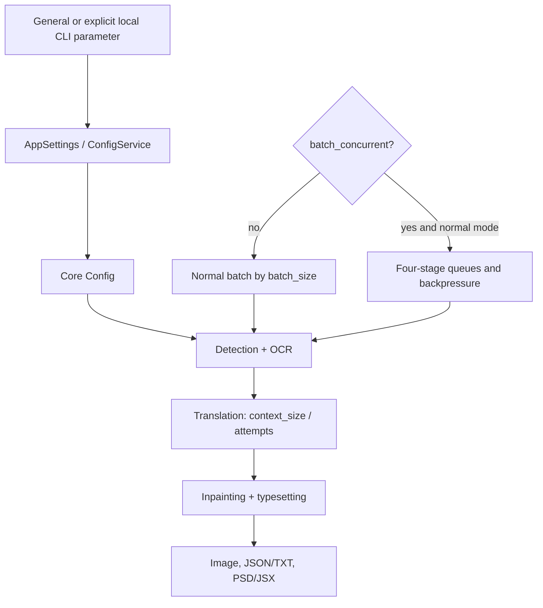

# CLI, Batch, and Output

This guide covers the CLI, batching, and output fields in General settings and explicit overrides from the local `local` CLI. It does not cover API credentials, detection/OCR/translator/typesetting algorithms. Configuration and screenshots must be sanitized: never show real keys, tokens, usernames, private absolute paths, user images, or private prompts.

## What these settings control {#feature-boundary}

This page includes logging, error isolation, GPU/ONNX, retries, translation context, batch/pipeline scheduling, format/quality/overwrite, text/JSON/TXT sidecars, source-directory output, PSD/JSX, the custom API-parameters file, and model cleanup after translation. `context_size` is actually in the Translation tab; workflow labels belong to the translation workspace, so this page records only their batch constraints.

## Change it in the desktop app {#ui-operations}

Open Settings and select the General tab. Numeric values use line edits, booleans use toggles, and `format` uses a combo box. The General layout comes from `tab_custom_1` in `settings_tab_layout.json`. Changes update memory and are merged to disk; importing configuration or switching presets can rebuild rows. The `Edit` action beside `use_custom_api_params` opens a JSON file; it is not another core configuration value.

The formal local CLI entry point is `manga_translator/args.py`: `python -m manga_translator local -i <sanitized input> [-o <sanitized output>]`. `-i/--input` accepts multiple values; `--config`, `-v/--verbose`, `--overwrite`, `--use-gpu`, `--disable-onnx-gpu`, `--format`, `--batch-size`, and `--attempts` can override configuration, but **an omitted value does not override it**. The formal top-level subcommands are `local`, `web`, `ws`, and `shared`; this page discusses only local input/output overrides.

## Parameters

> For the mapping of UI names, storage keys, and default values of the parameters on this page, see the [Settings Parameter Index](../../reference/settings-index.md).

#### Verbose Logging {#cli-verbose}

The “Verbose Logging” toggle is on Settings → General. Qt UI always creates `result/log_<timestamp>.txt` at startup, even when this toggle is off. Enabling it raises console output to DEBUG level and creates a per-image debug folder containing cached intermediate input, detection/OCR, inpainting, and rendering artifacts. Results are unchanged, but the extra files can be numerous and consume substantial disk space; use it only for troubleshooting. Default: `false`.

#### Retry Attempts {#cli-attempts}

“Retry Attempts” is an integer input. It sets how many times a translation request is retried after failure; `-1` means unlimited. It applies only to the translation/API request layer, not to a general detector/OCR/render retry, and it is not the high-quality retry. Default: `5` (five retries after the first request).

#### Skip after retries are exhausted {#cli-skip-failed-after-retries}

This toggle follows Retry Attempts in Settings → General and is on by default. Only retryable failures (timeouts, dropped connections, 429/5xx) are skipped; configuration errors such as an invalid API key, an unknown model name, or a deactivated account stay hard errors. Requests complete their existing retries and API failover before affected images are skipped. It does not retry the whole image pipeline. Standard translation, high-quality translation, concurrent processing, and API-based OCR, colorization and rendering share the policy. A retry count of `-1` still means unlimited retries.

#### Failure skip limit {#cli-max-failure-skips}

Applies only when skipping after retries is enabled. The default `5` stops the task as soon as the fifth image is skipped due to exhausted retries; `0` allows unlimited skips. Counts are cumulative across the task, including all concurrent batches, and successful images do not reset them. Each affected image in a failed batch counts separately. Existing outputs and other normal skips do not count. This limit takes precedence over Ignore Errors; cancellation always stops the task.

Completion logs and dialogs only summarize counts, paths and reasons for files skipped after exhausted retries; files skipped because their outputs already exist are omitted. Early-stop dialogs also include images previously skipped after exhausted retries. Configuration keys: `cli.skip_failed_after_retries` and `cli.max_failure_skips`.

#### Ignore Errors {#cli-ignore-errors}

When the “Ignore Errors” toggle is enabled, a failed image is recorded and processing continues with the remaining images; it does not turn failure into success and does not swallow cancellation. Default: `false`.

#### Use GPU {#cli-use-gpu}

The “Use GPU” toggle decides whether model loading and inference use the GPU. It requires matching drivers, Torch/CUDA, and VRAM; enabling it does not guarantee that every implementation uses the GPU. Default: `true`.

#### Disable ONNX GPU Acceleration {#cli-disable-onnx-gpu}

The “Disable ONNX GPU Acceleration” toggle forces only ONNX sessions onto the CPU and does not disable Torch CUDA. It can avoid provider conflicts at a speed cost. Default: `false`.

#### Context Pages {#cli-context-size}

“Context Pages” is on the Translation tab and is an integer input. The translator builds context from recent non-empty history pages; `0` or a negative value disables it. See [Context and Prompts](../translator/context-and-prompts.md) for details.

#### Batch Size {#cli-batch-size}

“Batch Size” is an integer input that controls how many images are submitted per translation batch, the concurrent queue bound, and the memory peak; it is not the number of images running at once, and special modes may force 1. Default: `3`.

#### Concurrent Batch Processing {#cli-batch-concurrent}

When the “Concurrent Batch Processing” toggle is enabled, detection+OCR, translation, inpainting, and typesetting run in parallel through queues. Multiple independent translation workers can request separate batches simultaneously. TXT import, JSON-only, original/translation export, colorize/upscale/inpaint-only, and replacement translation force concurrency off.

The waiting translation queue holds up to `batch_size × translation_concurrency` images. Detection waits when this queue is full to bound the backlog. High-quality translators take part in this pipeline too, so the two modes are not mutually exclusive. Default: `true`.

#### Translation Concurrency {#cli-translation-concurrency}

On Settings → General, “Translation Concurrency” sets the maximum number of simultaneous translation batches (`1–32`, default `3`). Enable Concurrent Batch Processing to use it. With Batch Size `3` and Translation Concurrency `3`, up to three requests, each containing three images, can run together. A worker takes the next batch immediately after its request finishes.

Responses may finish out of order while results remain associated with their source images. Each batch uses the pages that are already translated when it starts: they do not have to precede the current page or be contiguous, and only the batch's own pages are excluded. Set this value to `1` for full sequential translation context. Context applies to every translator (high-quality and Sakura included); only the rendering format differs. The translator's configured RPM limit still applies.

CLI example: `python -m manga_translator local -i ./manga_folder --concurrent --batch-size 3 --translation-concurrency 3`. The configuration key is `cli.translation_concurrency`.

#### Output Format {#cli-format}

“Output Format” is a combo box on Settings → General that decides the extension used when saving images.

- Not Specified: preserve the original extension.
- `png`: PNG.
- `jpg`/`jpeg`/`jfif`: JPEG (requires RGB conversion).
- `webp`: WebP, supports quality.
- `avif`: AVIF, requires Pillow codec support.
- `bmp`: BMP (requires RGB conversion).
- `tiff`/`tif`: TIFF.
- `heic`/`heif`: HEIF, requires codec support.

Default: Not Specified.

#### Overwrite Existing Files {#cli-overwrite}

When the “Overwrite Existing Files” toggle is off, existing image output is skipped and TXT/JSON workflows check their corresponding files; results contain skipped items. Default: `false`.

#### Skip Images Without Text {#cli-skip-no-text}

When the “Skip Images Without Text” toggle is enabled, images with no translatable text after detection/OCR are marked as skipped (`skip_reason=no_text`). The image and empty JSON/TXT are still written, but the page no longer enters translation or rendering. Detection and OCR still run, because otherwise the page could not be classified. This is a normal branch: it does not count as a failure and does not consume the `max_failure_skips` budget. Default: `true`.

#### Simple Text Order {#force-simple-sort}

With Simple Text Order on, panel detection is skipped and text boxes are ordered top to bottom, right to left. It removes one panel-detection subprocess per page, but multi-column pages may come out in the wrong order. The command line uses `--force-simple-sort` / `--no-force-simple-sort`. Default: `false`.

#### Editable Image {#cli-save-text}

When the “Editable Image” toggle is enabled, JSON sidecar data containing regions, original/translated text, dimensions, and rendering fields is exported; combined with “Export Original Text” it also exports the original TXT. Default: `true`.

#### Image Save Quality {#cli-save-quality}

“Image Save Quality” is an integer input applied to image, inpainting, and editor saves. Higher values usually make files larger; exact semantics depend on the encoder. Default: `100`.

#### Lossless Image Save {#cli-save-lossless}

The “Lossless Image Save” toggle enables lossless encoding for WebP, AVIF, and HEIC/HEIF; “Image Save Quality” is then ignored. AVIF uses the AOM encoder bundled with pylibheif, full-range 4:4:4, and reversible RGB storage, and keeps the source ICC profile. Output is always 8-bit: 16-bit or floating-point input is quantized to 8-bit first, matching how JPEG/BMP/HEIC/WebP already behave, so a batch is never aborted. Default: `true`.

#### Compression Effort {#cli-compression-effort}

“Compression Effort” is an integer input from `0` to `100` for PNG and lossless WebP/AVIF/HEIC/HEIF. AVIF maps the value to AOM encoder speed (9 down to 0) and HEIC/HEIF to x265 presets; `0` is fastest while `100` compresses hardest and is slowest. Clearing the field or entering an invalid value restores `100`. Default: `100`.

#### Save to Source Directory {#cli-save-to-source-dir}

When the “Save to Source Directory” toggle is enabled, results are written beside the source under `manga_translator_work/result`; otherwise the output directory is used and relative structure is preserved when possible. The directory must be writable. Default: `false`.

#### Export Editable PSD {#cli-export-editable-psd}

When the “Export Editable PSD” toggle is enabled, the final stage creates Photoshop PSD/JSX; running the script requires Photoshop, and this is not an ordinary image format. Default: `false`.

#### Generate PSD Script Only {#cli-psd-script-only}

When the “Generate PSD Script Only” toggle is enabled, only the JSX script is generated and Photoshop is not run; the script can contain paths and must not be shared directly. Default: `false`.

#### Use Custom API Params {#use-custom-api-params}

When the “Use Custom API Params” toggle is enabled, `config/custom_api_params.json` is read to attach extra request parameters; the adjacent `Edit` button opens that JSON file. See [Custom Request Parameters](../api-management/custom-request-parameters.md) for details.

#### Unload Models After Translation {#app-unload-models-after-translation}

When the “Unload Models After Translation” toggle is enabled, the desktop unloads models after a task completes, reducing resident memory at the cost of the next task’s loading time. Default: `true`.

This switch is desktop-only: neither the CLI nor the server implements an end-of-task unload. On the server, an administrator triggers model release from the cleanup panel instead.

#### Concurrency on the Web {#web-concurrency}

`cli.batch_size` and `cli.use_gpu` are server-side controls listed in `server/routes/config.py#SERVER_HIDDEN_CONFIG_KEYS`, so they never appear in the Web config form; server-wide parallelism comes from `max_concurrent_tasks`.

`cli.batch_concurrent`, `cli.translation_concurrency`, and `cli.context_size` are visible on the Web and apply per request: the server creates one `MangaTranslator` instance per task (model weights and idle timestamps stay process-wide), so pipeline state, context, and cancellation cannot leak between requests.

The global default comes from the server config file `config/config.json` (`cli` section; the built-in fallback is pipeline on, 3 translation workers, 3 context pages), and the Web form shows those values. A request that carries explicit values overrides them. A task's `translation_concurrency` is capped by `max_concurrent_tasks`; in-flight requests are roughly `max_concurrent_tasks × translation_concurrency`, so lower or disable it when VRAM or API rate is tight.

Upscale-only, colorize-only, inpaint-only, load-text, and both export endpoints now run their actual workflow instead of degrading to a normal translation; those special workflows still force sequential processing.

## How the settings take effect {#runtime-behavior}

UI/configuration file data goes through `AppSettings`/ConfigService, memory configuration, core `Config`, `MangaTranslator`, and export consumers. `local` in `mode/local.py` applies only explicitly supplied CLI values to `cli`; desktop `app_logic.py` additionally builds `save_info` with output directory, format, overwrite, and source-directory flags.

`batch_size` is the translation batch and concurrent translation queue bound; `batch_concurrent` is stage-pipeline parallelism, not an API concurrency count. TXT import, JSON-only, original/translation export, colorize/upscale/inpaint-only, and replacement translation disable it to preserve ordering and per-image file writes. `context_size` builds messages from recent non-empty pages; `attempts`, HQ quality retry, and API candidate rotation are separate layers; cancellation is not an ignorable error.

## Interactions and caveats {#dependencies-and-conflicts}

GPU backends require compatible drivers, Torch/CUDA, and ONNX providers. Larger batches, concurrency, more context, and high-quality output increase resource, token, or disk pressure; for OOM, lower batch size or disable concurrency before increasing retries. Disabled overwrite skips images/TXT/JSON. Template and JSON-only workflows require matching work-directory files. PSD execution requires Photoshop; JSX/JSON/TXT can expose paths and text, so sanitize before sharing. Format encoding depends on Pillow and platform codecs.
